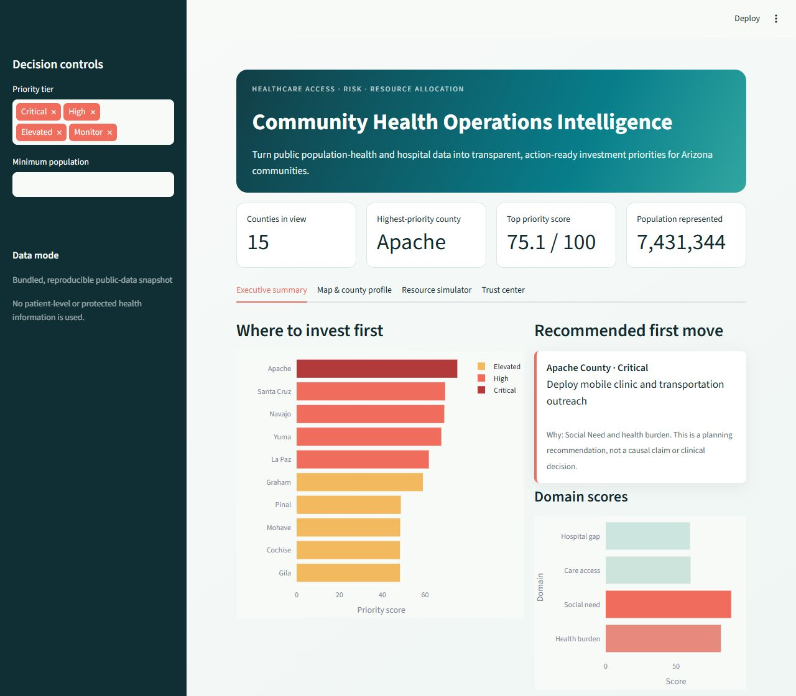
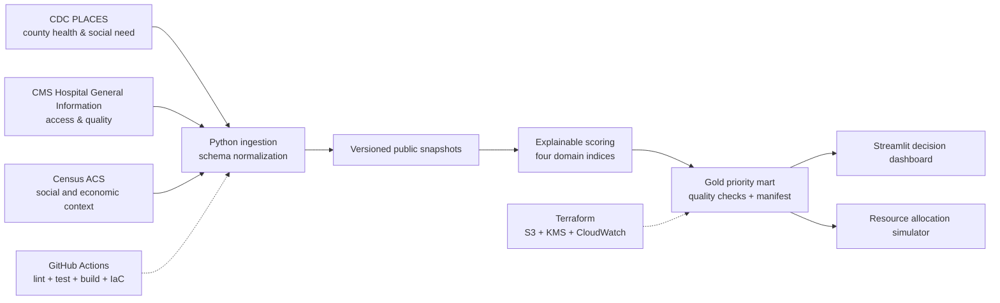

# Community Health Operations Intelligence

[](https://www.python.org/)
[](https://streamlit.io/)
[](https://www.terraform.io/)
[](#data-governance)

## The short version

Imagine Arizona has one box of money for community healthcare, but 15 counties need help. This
project helps a planning team decide **which counties may need help first and why**.

It takes public information from the CDC, Census, and CMS, lines up the information by county,
and gives each county a planning score from 0 to 100. The dashboard then shows:

- which counties have the greatest combination of health and access challenges;
- what is pushing each county's score higher;
- an action the planning team could investigate; and
- how a limited pretend budget could be divided without overspending.

```text
Public government data
        ↓
Clean and match Arizona's 15 counties
        ↓
Calculate simple, explainable scores
        ↓
Check the data for mistakes
        ↓
Show rankings, reasons, and possible actions in a dashboard
```

This is **not** a doctor, a patient-risk system, or a tool that makes medical decisions. It uses
county-level totals and estimates—not people's names or medical records. Its recommendations are
starting ideas that should be checked with local experts and community members.



## What happens when you run it

The platform turns three separate public datasets into one repeatable workflow:

1. **Load:** read the included CDC, Census, and CMS data files.
2. **Clean:** make county names, ID numbers, units, and missing values work together.
3. **Score:** compare each county with the other Arizona counties in four areas.
4. **Rank:** combine those areas into one 0–100 planning score.
5. **Explain:** show the two biggest reasons for the score and suggest a possible response.
6. **Display:** put the results into a dashboard and a pretend budget-planning tool.

The pipeline creates three main files in `data/gold/`:

- `mart_community_priority.csv`: the county rankings and explanations;
- `data_quality_report.csv`: the results of automatic data-contract and quality checks; and
- `build_manifest.json`: a receipt showing when and how the data was built.

For example, Apache County ranks first in the included snapshot at **75.1/100**. The dashboard
does not merely show that rank: it identifies social need and health burden as the leading
drivers, recommends mobile-clinic and transportation outreach, and shows how the county fits
within a constrained budget. Every recommendation remains a planning hypothesis that requires
local validation and community input.

## Decision product

- Ranks all 15 Arizona counties across health burden, social need, care access, and hospital gap.
- Explains the two strongest drivers behind every recommendation.
- Maps priority and opens a county-level health/access profile.
- Allocates a configurable budget without overspending it.
- Surfaces missing hospital-rating data as uncertainty—not as poor quality.
- Enforces source contracts and automated data-quality controls and records build metadata.
- Uses only public, aggregate data; no patient-level data or PHI is present.

## How to use it

You do **not** have to write the dashboard yourself. The code is already built. The first time,
you download the repo, prepare Python, build the results, and start the dashboard.

### Option 1: Windows PowerShell

Install [Git](https://git-scm.com/downloads) and [Python 3.11 or newer](https://www.python.org/downloads/),
then run these commands one at a time:

```powershell
git clone https://github.com/Akqadafi/healthcare-decision-intelligence-platform.git
cd healthcare-decision-intelligence-platform
python -m venv .venv
.\.venv\Scripts\Activate.ps1
python -m pip install -e ".[dev]"
python -m healthcare_di.pipeline
streamlit run dashboard/app.py
```

Open <http://localhost:8501> if it does not open by itself. Keep the PowerShell window running
while you use the dashboard. Press `Ctrl+C` in that window when you want to stop it.

| Command | What it means in simple language |
|---|---|
| `git clone ...` | Download a copy of the project. You only do this once. |
| `cd ...` | Walk into the project's folder. |
| `python -m venv .venv` | Make a private Python toolbox for this project. |
| `Activate.ps1` | Turn on that toolbox. |
| `pip install ...` | Put the project's required Python packages in the toolbox. |
| `python -m healthcare_di.pipeline` | Read, clean, check, score, and save the included data. |
| `streamlit run dashboard/app.py` | Start the dashboard on your computer. |

The next time you want to open the dashboard, return to the project folder and run:

```powershell
.\.venv\Scripts\Activate.ps1
streamlit run dashboard/app.py
```

You only need to run the pipeline again when you change the data or scoring code, want to rebuild
the output, or delete the files in `data/gold/`.

If PowerShell blocks the activation script, run this once in the same PowerShell window and then
try activation again:

```powershell
Set-ExecutionPolicy -Scope Process -ExecutionPolicy Bypass
```

### Option 2: macOS or Linux

Use the same commands as above, but activate the toolbox with:

```bash
source .venv/bin/activate
```

### Option 3: Docker

If Docker Desktop is installed and running, this single command builds and starts the app:

```bash
docker compose up --build
```

Then open <http://localhost:8501>. Press `Ctrl+C` to stop it.

### Included data versus fresh data

The normal pipeline command uses public-data snapshots already stored in the repo. That makes the
demo predictable and means **you do not need an API key**:

```powershell
python -m healthcare_di.pipeline
```

Fresh-data mode asks the government APIs for newer CDC, CMS, and Census data. It requires a Census
API key and can produce different rankings when the agencies update their data:

```powershell
$env:CENSUS_API_KEY = "YOUR_KEY"
python -m healthcare_di.pipeline --live
```

Never paste a real API key into the README, source code, or Git history. An API key should be kept
in an environment variable like the example above.

### What you should see

- Rankings for all 15 Arizona counties.
- Apache County at 75.1/100 in the included snapshot.
- Tabs for the executive summary, county profile, resource simulator, and trust center.
- Passing source-contract and data-quality checks in the generated quality report.

For Terraform prerequisites, AWS cost safeguards, exact apply/destroy commands, verification,
and dashboard deployment choices, use the [step-by-step deployment runbook](docs/runbooks/DEPLOYMENT.md).

## Architecture



Detailed lineage and architectural decisions are in [architecture/](architecture/).

## Transparent scoring

All inputs are converted to within-state rank percentiles (0–100) before weighting, which keeps
different units comparable and makes the result easy to audit.

| Domain | Inputs | Overall weight |
|---|---|---:|
| Health burden | Obesity, diabetes, hypertension, poor physical health, poor mental health | 35% |
| Social need | Poverty, food insecurity, lack of insurance, inverse median household income | 25% |
| Care access | Transportation barriers, low annual-checkup rate, low hospital density | 25% |
| Hospital gap | Inverse CMS average star rating; neutral-high uncertainty score when unavailable | 15% |

The weighted index is a planning heuristic—not a causal model or a clinical risk score. See the
[model card](ml/model_cards/community_priority_score.md) for intended use, limitations, and
validation requirements.

## Public sources

| Source | Dataset | Included snapshot |
|---|---|---|
| CDC PLACES | County GIS-Friendly Format, 2025 release (`i46a-9kgh`) | Retrieved 2026-08-15 |
| CMS Provider Data Catalog | Hospital General Information (`xubh-q36u`) | Modified 2026-04-28; retrieved 2026-08-15 |
| Census ACS 5-year | 2020–2024 income and poverty estimates | Snapshot included; live refresh requires `CENSUS_API_KEY` |

Refresh all three live sources after setting `CENSUS_API_KEY`:

```bash
python -m healthcare_di.pipeline --live
```

The live command can change scores as source agencies revise their data. Snapshot mode is the
default for review, tests, and portfolio demonstrations, and it does not require credentials.

## Repository map

```text
dashboard/                 Executive decision application
src/healthcare_di/         Ingestion, scoring, quality, and pipeline code
data/snapshots/            Reproducible public aggregate inputs
data/gold/                 Generated decision mart and quality evidence
data_contracts/            Source-level contracts
transformations/           dbt-ready analytics models
database/                  PostgreSQL warehouse schema
infra/terraform/           Safe-by-default AWS foundation
docs/runbooks/             Deployment and operations instructions
architecture/              Diagram, lineage, and ADRs
ml/model_cards/            Model governance
portfolio/                 Portfolio-ready case study and project card
tests/                     Unit and contract tests
```

## Validation

```bash
ruff check .
pytest
python -m healthcare_di.pipeline
terraform -chdir=infra/terraform fmt -check -recursive
terraform -chdir=infra/terraform init -backend=false
terraform -chdir=infra/terraform validate
docker build -t community-health-intelligence .
```

GitHub Actions runs the Python, data build, Terraform, and container checks on every pull request.

## AWS foundation

Terraform defines a versioned, KMS-encrypted S3 data lake and encrypted CloudWatch log group.
Cloud resources are disabled by default to prevent accidental spend. Review the plan, set a
globally unique bucket name, and explicitly opt in:

```bash
terraform -chdir=infra/terraform init
terraform -chdir=infra/terraform plan \
  -var="deploy_cloud_resources=true" \
  -var="data_lake_bucket_name=YOUR-GLOBALLY-UNIQUE-NAME"
```

No `terraform apply` is run by CI.

Terraform also defines an independently gated ECR/ECS Fargate hosting environment, an ALB,
networking, deployment events, and GitHub OIDC roles. Hosting remains disabled by default.
See the [AWS release and rollback runbook](docs/runbooks/AWS_HOSTING.md) and
[cost review](docs/runbooks/COST_REVIEW.md) before creating resources. Cloud deployment and
recovery results must be verified before being claimed.

## Data governance

- Public aggregate datasets only; PHI is prohibited by contract.
- Source IDs, vintages, retrieval dates, and lineage are recorded.
- County FIPS is the canonical geographic key; name normalization is limited to the CMS join.
- Missingness is visible in the dashboard and model output.
- Recommendations require local validation and community input before operational use.
- This project is a planning demonstration, not medical advice.

## Portfolio story

See the [portfolio case study](portfolio/CASE_STUDY.md) for an interview-ready explanation,
engineering decisions, and résumé bullets. The project connects healthcare analytics, data
engineering, explainable modeling, DevOps, and governance in one product.

## Roadmap

- Additional Census ACS variables and automated refresh after a key is configured.
- HRSA shortage-area measures and provider workforce capacity.
- ZCTA-level drill-down for Maricopa County.
- Maternal/infant health module using CDC WONDER Natality.
- Athena catalog; execute the container deployment and recovery demonstration after AWS plan/cost approval.

## License

MIT. Source datasets remain subject to their agencies' terms and attribution guidance.


PostgreSQL is optional (`docker compose --profile warehouse up`). The dashboard serves validated CSV outputs; the PostgreSQL schema and dbt models are scaffolding and are not an exercised warehouse pipeline.

[Historical AWS evidence](docs/evidence/README.md) · [Modeling roadmap](docs/MODELING_PLAN.md)
