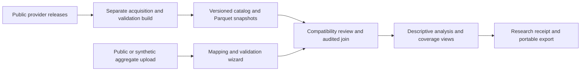

# Public Health Research Workbench — implementation plan

Prepared October 14, 2026. Status: proposed design; no workbench features have been implemented or deployed.

## 1. Product decision

Build a guided workspace for comparing public community conditions with researcher-supplied service data. The flagship question is:

> Which counties have substantial health needs and relatively low recorded outreach participation?

The result identifies places for further investigation. Low participation does not establish unmet need, ineffective outreach, or the effect of an intervention.

Keep the current Arizona dashboard as a named planning template. Researchers should be able to investigate raw measures without using its weighted priority score. Preserve its existing calculations and Apache's 75.1 baseline in regression tests.

The first release supports county-level community analysis, public/synthetic aggregate CSV and XLSX uploads, descriptive comparisons, and portable study exports. National coverage is a release requirement, preceded by an Arizona pilot. Survey microdata, predictive modeling, confidential uploads, team collaboration, and persistent cloud accounts are later milestones.

## 2. What can be reused

| Existing component | Reuse | Change needed |
|---|---|---|
| Source ingestion and contracts | Provider adapters and validation patterns | Add release metadata, uncertainty, national geography, pagination and source-specific missing-value handling |
| Arizona scoring and allocation | Optional planning template | Isolate Arizona assumptions from general research operations; keep comparison cohort explicit |
| Streamlit, Plotly and desert branding | Guided interface and charts | Add study workflow and file mapping; retain the original dashboard |
| Dataset hash and quality reports | Dataset identity and fail-closed serving | Version public releases and link study receipts to their checksums |
| Python tests and browser CI | Regression framework | Add upload, compatibility, join, export and national-data tests |
| Terraform, container and AWS runbooks | Future deployment foundation | Do not deploy the proposed AWS stack during the public prototype |

Current gaps: the app has no upload wizard, national registry, uncertainty-aware catalog, study persistence, research receipt, or outcome labels. Its validators currently require Arizona's 15 county identifiers. PostgreSQL/dbt scaffolding is not an exercised warehouse path.

## 3. Researcher workflow and screens

| Screen | Researcher action | Required result |
|---|---|---|
| Start a study | Enter question, state/counties, geographic level, study period, and intended comparison | Study configuration with explicit scope and assumptions |
| Select public measures | Search a curated catalog by concept | Definitions, units, denominator/universe, observation period, release, geography vintage, uncertainty, and source link before selection |
| Add service data | Upload CSV/XLSX, choose sheet, map columns, define whether counts mean contacts or unique people | Profile, mapping preview, validation report and input checksum |
| Review compatibility and joins | Review geography matches, periods, duplicate groups and missing matches | Explicit join policy and a report accounting for every input record |
| Explore coverage | Select measures and an appropriate participation denominator | Tables, descriptive charts, geography view and clearly labeled comparisons |
| Save/export | Download study configuration or a reproducibility package | Restorable study settings, results, figures, receipt and runnable analysis recipe |
| Arizona planning template | Open existing case study and allocation scenario | Existing baseline remains available and unchanged |

Navigation should show progress and explain why an analysis is blocked. Researcher choices live in an independent study object; widgets are views of that object, not the sole storage of decisions.

## 4. Public catalog and national coverage

Begin with a curated set of concepts already supported by the project: diabetes, obesity, insurance, transportation, poverty, income, population, hospital availability, and hospital-rating context. Catalog entries must name exact provider variables rather than relying on keyword guesses.

CDC documents county, place, tract and ZCTA formats and both long and GIS-friendly layouts. County is the initial supported geography; finer levels require separate compatibility work. [CDC PLACES portal guidance](https://www.cdc.gov/places/tools/explore-places-data-portal.html)

ACS integration must retain estimates, available margins of error, and applicable annotations. Its period estimates must be labeled separately from release dates. Verify variable codes, universes and metadata before implementation. [ACS developer documentation](https://www.census.gov/data/developers/data-sets/acs-5year.html)

National acquisition is a separate build job, not a request made every time a visitor opens the app. Fetch a pinned release, paginate completely, record retrieval metadata, validate against a versioned county/county-equivalent registry, and publish an immutable Parquet release. Include geographic exclusions and coverage gaps in its manifest. The application reads selected states, counties and measures from that release.

CMS remains a contextual facility source. Resolve facility counties through an explicit registry with a reviewed name/state mapping where FIPS is unavailable. Report missing ratings separately from quality judgments. Do not assume the current aggregated Arizona fixture contains every raw hospital field.

National release acceptance requires at least two states in integration tests, documented complete-fetch checks, an explicit county-equivalent/boundary policy, and reproducible provider-variable mappings. Do not advertise nationwide coverage from an Arizona-only fixture.

## 5. Upload wizard and join rules

Initial upload limits are proposed engineering defaults: 10 MiB per file and 100,000 parsed rows. Enforce both before analysis; measure resource use and revise deliberately. Accept CSV and XLSX only, with an explicit sheet choice. Reject macros and unsupported formats; do not execute formulas, embedded code, or uploaded scripts. Exports must neutralize spreadsheet formula injection while retaining the original input checksum and recording any escaping.

Suggested mappings are advisory. Researchers confirm county FIPS or county/state, reporting period, count, program type, and the unit counted. Preserve leading zeros. Use exact registry matches first. County names without a state, ambiguous names, unknown codes and fuzzy matches require resolution; never choose silently.

Declare the intended grain, for example county × reporting month × program. Preview duplicate keys. Block a many-to-many join. Permit aggregation only after the researcher selects the grouping and aggregation rule; record the original and resulting row counts. Summing distinct-person counts across months does not yield annual unique people without additional evidence.

The join report contains matched rows, upload-only rows, public-data-only counties, ambiguous records, duplicate groups, exclusions and reasons. All input rows must be accounted for. Unmatched records remain downloadable. Missing service records are unknown, not zero; an explicit zero is different.

Record source observation periods, release dates, geography vintage, measure definitions and denominators. Incompatible geographic levels block the join in this release. Temporal mismatches trigger review; allowed descriptive comparisons record the mismatch and override rationale. Changes of boundaries and overlapping ACS periods cannot silently become year-to-year trends. [Census comparison guidance](https://www.census.gov/programs-surveys/acs/guidance/comparing-acs-data.html)

## 6. Flagship analysis and visuals

Show public need measures alongside recorded service activity. Researchers choose the need measure, geography set, period and comparison denominator. Start with raw measures rather than forcing a single need index.

| View | Purpose | Guardrail |
|---|---|---|
| Need versus activity scatterplot | Compare a chosen health/social measure with recorded participation | Label associations; do not imply causality |
| Coverage/activity comparison | Compare service records per a compatible population denominator | Total population yields a population-normalized activity rate, not the share of eligible people served |
| County table and geography view | Inspect values, missingness and source context | Show unmatched counties and a tile-free fallback |
| Uncertainty display | Show supplied intervals or margins of error alongside estimates | Preserve confidence levels and methods; do not fabricate intervals when absent |
| Investigation quadrants | Identify relatively high need and low recorded activity | Thresholds are explicit researcher choices; zeros and unknowns stay distinct |

For unique people served divided by a matching eligible population, a participation proportion may be meaningful. For contacts, use an activity rate such as contacts per 1,000 residents; repeat contacts can exceed the population. Denominator population, age range and period must be explained before calculation. Adult prevalence should not be multiplied by total population and called an exact number of eligible people.

Do not claim that correlations predict intervention success. Avoid automatic significance testing across the catalog. Survey-design statistics, spatial models and respondent-level regression are outside this first release.

## 7. Research receipt and portable workspaces

Every study has a schema-versioned receipt containing:

- Study question, scope, periods and unit of analysis.
- Public dataset release IDs, checksums, variable definitions and uncertainty metadata.
- Upload checksum, file/sheet selection, confirmed column mapping and counting definition.
- Geography resolutions, join keys/cardinality, matched/unmatched counts, exclusions and reasons.
- Cleaning/aggregation transformations, missing-data rules and compatibility decisions.
- Analysis settings, denominators, thresholds, assumptions and limitations.
- Application commit, dependency versions, execution timestamp and result checksums.

Save a portable study file and let the researcher restore it later. A settings-only file cannot reproduce results without the exact input data, so say this explicitly. The richer ZIP export contains receipt JSON, analysis configuration, joined/exception tables, figures, and a deterministic Python recipe. Including the original upload is a separate explicit choice. Do not include secrets, arbitrary executable user content, or proprietary data by default.

Import validates the schema, expected file names, byte/row limits and checksums. Reject archive path traversal and oversized/decompression-bomb archives. Run only the application's allowlisted analysis steps; never execute code contained in an imported package.

The public prototype does not promise persistent private accounts or collaboration. Session state preserves an active visit; downloaded study files provide durability. Private, server-saved workspaces are a later capability.

## 8. Architecture and operating costs

For the prototype, reuse Streamlit and Python. Use Parquet and column/state selection; introduce DuckDB only if benchmarks show a useful memory/query benefit. Neither Glue nor Athena is a prerequisite for county-level data. Keep large acquisition artifacts outside Git and provide a reproducible build plus a documented public-artifact location before national sharing. Small public fixtures remain in the repo for CI.

Start locally, then evaluate the existing Community Cloud deployment using public/synthetic inputs, bounded uploads, and measured memory/concurrency. Browser uploads reach the hosting server; this is not on-device processing. Do not accept confidential files on the public demo. An identifier scanner or a consent checkbox does not provide privacy assurance.

Later private architecture: authenticated application, tenant-scoped PostgreSQL metadata, private S3 uploads/releases, queued jobs and ECS workers. Add a queue and job state machine if processing becomes asynchronous; Fargate workers alone do not provide scheduling, retries or ownership. Add Glue/Athena only for justified query scale. Require private-object access, authorization on every job/export, retention/deletion policies, TLS and reviewed logging before confidential uploads.

No AWS resources need to be created for planning or the first local prototype. Prepare a component-level cost estimate and teardown plan before any cloud expansion; the old dashboard's roughly $45/month baseline is not an estimate for the proposed workbench stack.

## 9. Proposed code organization

Keep `dashboard/app.py` operational while extracting reusable components. Add dedicated modules with unit-testable functions:

| Module | Responsibility |
|---|---|
| `catalog` / `providers` | Release manifests, variable metadata and provider acquisition |
| `geography` / `compatibility` | Registry resolution, geography/period/universe rules |
| `uploads` / `contracts` | Bounded parsing, mapping, schema checks and profiles |
| `studies` / `joins` | Versioned study configuration, transformation decisions and join reports |
| `analysis` | Descriptive comparisons and coverage/activity calculations |
| `exports` | Receipt, safe ZIP import/export, figures and reproducible recipe |
| `dashboard/workbench` | Guided screens and state bindings |

General contract validation accepts an explicit geographic scope and expected registry. Keep the strict 15-county rule inside the Arizona template. A public observation model should support geography ID/type/vintage, variable ID, estimate, units, universe, observation period, release, uncertainty fields, status/annotation and source checksum. Do not flatten different periods or estimate types into an unqualified single value.

## 10. Build sequence and acceptance gates

| Milestone | Work | Completion gate |
|---|---|---|
| 0 — Specification and fixtures | Agree receipt/study schemas; create synthetic county-month service records; define catalog metadata and counting semantics | Example study has a reproducible expected answer; existing dashboard tests still pass |
| 1 — Arizona workflow pilot | Study setup, CSV/XLSX wizard, confirmed mappings, compatibility review, audited joins | No silent duplicate aggregation or record loss; one complete upload-to-export journey works |
| 2 — National catalog | Release acquisition, county registry, uncertainty metadata, filtered Parquet access | Complete-fetch checks and multi-state tests pass; exclusions/vintages documented |
| 3 — Analysis and reproducibility | Coverage views, uncertainty, portable workspace/ZIP, deterministic recipe | Restoring a study reproduces the same tables and receipt decisions from matching inputs |
| 4 — Public demonstration | Bounded public/synthetic uploads, CI browser checks, documentation and measured load tests | Demonstration works on agreed hosting limits; no confidential-data promise; original case study remains available |
| 5 — Private collaboration | Authentication, tenant authorization, durable storage, jobs, retention and cost-reviewed infrastructure | Cross-workspace isolation, deletion and job/export authorization verified before confidential use |
| 6 — Additional research methods | Tracts/ZCTAs, survey design, appropriate regression and optional ROI scenarios | Method-specific data and validation requirements satisfied before publication |

Milestones 1–4 constitute the proposed public county workbench release. An Arizona-only pilot is a preview, not the national product. Do not commit to calendar dates until national acquisition, export size, mapping edge cases and hosting limits have been tested.

## 11. Verification and evidence

Unit/integration tests must cover leading-zero FIPS, ambiguous county names, invalid ranges, missing/suppressed source values, duplicate keys, failed joins, period mismatches, explicit zeros versus missing service records, incompatible denominators, multi-state registry coverage, malformed XLSX/CSV, formula-safe exports, archive limits and receipt round-trips.

Browser tests must verify an actual upload and mapping review, blocked invalid joins, matched/unmatched totals, correctly formatted results, rendered geography points, retained study settings, downloadable results and restoration. Run the exported recipe in a clean container against known fixtures and compare table checksums or documented numeric tolerances.

Record dataset dimensions, selected columns, read/analysis/export time, peak memory, file-size boundaries and simultaneous session behavior on the target host. Choose and publish performance targets after the baseline measurements; do not call the platform capable of massive datasets without evidence.

Never send uploads or record contents to analytics, error logs or CI artifacts. Public catalog refresh failures leave the previous validated release available. Pin dependencies, verify the non-root image, preserve deployment evidence, and keep OIDC/TLS/alarms as explicit gates for a later AWS service.

## 12. Modeling after the workbench is reliable

Follow the existing `MODELING_PLAN.md`: begin with sensitivity analysis and assumption-driven cost/ROI scenarios. Forecasting needs comparable historical observations; logistic regression needs an actual binary outcome and an appropriate evaluation split. The current county snapshots do not contain program completion or realized savings labels.

Separate community aggregate analysis from future respondent-level survey analysis. Survey weights, clustering and stratification require method-specific handling. Do not infer individual risk from community averages. An optional AI assistant may explain confirmed metadata or draft a receipt narrative, but cannot invent variables, choose ambiguous joins, or turn descriptive associations into outcome claims.

## Recommended first implementation task

Build Milestone 0 and the Arizona upload-to-export pilot together using synthetic county-month participation counts. Its deliverable is one complete, reproducible study—not a collection of unfinished screens. Use that pilot to verify the workflow and schemas before widening the catalog nationally or adding AWS services.
